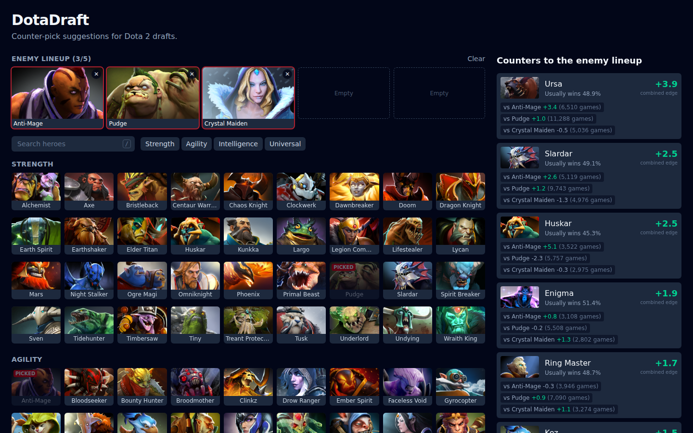
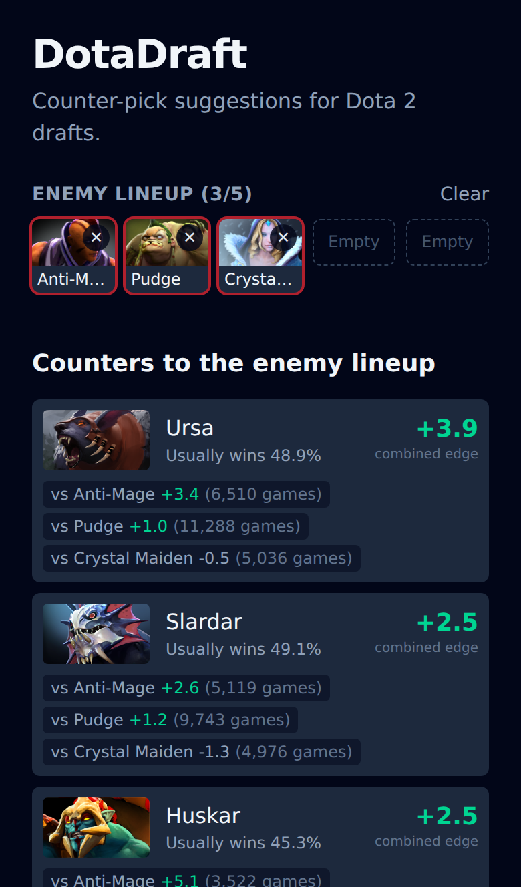

# DotaDraft

A Dota 2 draft helper. Pick up to five enemy heroes, and DotaDraft suggests the heroes that counter that lineup best, leaving out any your own team has already picked, using matchup data from public ranked matches via the [OpenDota API](https://docs.opendota.com).



<p align="center">
  
</p>

The backend is an ASP.NET Core Minimal API with PostgreSQL. The frontend is an Angular app styled with Tailwind CSS (`DotaDraft.Web/`).

DotaDraft isn't hosted anywhere yet. To try it, run it locally as described below.

## Prerequisites

- [.NET 10 SDK](https://dotnet.microsoft.com/download)
- [Docker](https://docs.docker.com/get-docker/) (for PostgreSQL, and for the API tests)
- EF Core CLI, pinned in `dotnet-tools.json`: run `dotnet tool restore` once after cloning
- [Node.js](https://nodejs.org/) 20.19+ (for the frontend)

## Local setup

Secrets never live in the repo. The database password goes in a gitignored `.env` file (read by Docker Compose), and the app's connection string and keys go in [user-secrets](https://learn.microsoft.com/aspnet/core/security/app-secrets), which are stored outside the project folder in `~/.microsoft/usersecrets/`.

1. **Database password.** Copy the template and choose a password:

   ```bash
   cp .env.example .env
   ```

2. **Start PostgreSQL:**

   ```bash
   docker compose up -d
   ```

3. **App secrets.** Use the same password as in `.env`:

   ```bash
   dotnet user-secrets set "ConnectionStrings:DefaultConnection" \
     "Host=localhost;Port=5432;Database=dotadraft;Username=postgres;Password=<your password>" \
     --project DotaDraft.Api

   # Optional: an OpenDota API key (https://www.opendota.com/api-keys) for higher rate limits
   read -rsp "OpenDota API key: " KEY && echo && dotnet user-secrets set "OpenDota:ApiKey" "$KEY" --project DotaDraft.Api; unset KEY
   ```

   Run `dotnet user-secrets list --project DotaDraft.Api` to see the values later.

4. **Create the schema:**

   ```bash
   dotnet ef database update --project DotaDraft.Api
   ```

5. **Run the API** on http://localhost:8080:

   ```bash
   dotnet run --project DotaDraft.Api --launch-profile http
   ```

   On first start it seeds heroes and matchups from OpenDota in the background, which takes about 1.5 minutes (see [Seeding](#seeding)).

6. **Run the frontend** on http://localhost:4200, in a second terminal:

   ```bash
   cd DotaDraft.Web
   npm install
   npm start          # ng serve
   ```

   In development it calls the API at `http://localhost:8080` (set in `src/environments/environment.development.ts`). CORS already allows the dev server's origin.

   The draft is kept in the URL, e.g. `http://localhost:4200/?against=1,14&team=5` (the enemy lineup, then your own team's picks), so a refresh keeps your picks and you can share a draft as a link. Your team's picks are never suggested as counters.

## Seeding

The API fills the database itself, in the background:
- **Every 24 hours** (`Seeding:IntervalHours`), counted from when the last successful seed finished, so new patches and matches are picked up. That time is stored in the database (`SeedingStates`), so restarts don't reset the clock: a restart seeds straight away only if the last seed is older than the interval.
- **At startup** if there are no matchups, or no seed has been recorded. On a fresh database the data appears about 1.5 minutes after the API starts.

Each run fetches heroes first, then matchups. Progress and errors go to the API's logs. A failed run is logged and retried with exponential backoff starting at `Seeding:RetryDelayMinutes` (default 5 minutes), capped at `Seeding:IntervalHours`.

To re-seed locally right away, empty the matchup table and restart the API:

```bash
docker exec dota_postgres psql -U postgres -d dotadraft -c 'TRUNCATE "HeroMatchups";'
```

- **Matchups come from public ranked matches.** DotaDraft runs SQL through OpenDota's [`/explorer`](https://docs.opendota.com/#tag/explorer) endpoint over its `public_matches` table: ranked All Pick games, counting every hero against every hero on the other team. The explorer stops queries after about 15 seconds, so the seed walks back from the newest match in windows of `WindowSize` match IDs (default 15 × 200,000, roughly the last 1.5 days) and adds the windows together. That's about 16 requests and a median of roughly 1,900 games per matchup.
- **A matchup seed replaces the whole table.** Pairs that no longer appear are removed. Each hero's baseline win rate (see [How counters are ranked](#how-counters-are-ranked)) is recalculated in the same save, so it always matches the matchups. If fewer than half the windows can be fetched, nothing is written and the existing data is kept. If only some fail, the rest is saved and the failure is logged.
- **`/explorer` isn't a stable, documented API.** If OpenDota changes its schema, the queries fail with an `err` message in the logs, and seeding fails while the existing matchups are kept.
- Requests are sent one at a time, and each explorer query takes a few seconds, so a seed stays well under the free tier's 60 requests/minute without any extra spacing. Rate-limit responses (429) are retried with backoff, honouring `Retry-After`.

## API

The full API reference, with every parameter, response and schema, is the OpenAPI document. It's generated from the code, so it can't drift from it. Run the API in Development and open [`/scalar`](http://localhost:8080/scalar) to browse it and try each endpoint, or fetch the raw document at `/openapi/v1.json`. Its descriptions come from the endpoints' and DTOs' `///` comments. This table is only an overview:

| Method | Path | Description |
|---|---|---|
| `GET` | `/api/heroes` | All heroes, sorted by name |
| `GET` | `/api/counters?against=1&against=14&exclude=5&role=Support&limit=10` | Top counter-picks against an enemy lineup of 1–5 heroes, leaving out up to 5 `exclude`d heroes such as your own team's picks, optionally only heroes with a `role` (`limit` 1–20) |
| `GET` | `/api/team-matchup?team=82&team=26&against=1&against=14` | How each of your team's 1–5 heroes does against the enemy lineup, scored like a counter suggestion, plus the team's combined edge |
| `GET` | `/health` | `Healthy` (200) when the API can reach the database, otherwise `Unhealthy` (503) |

`/health` is meant for uptime monitors and hosting platforms. It answers in plain text, isn't listed in the OpenAPI document, and is the same in every environment.

Example requests are in [`DotaDraft.Api/DotaDraft.Api.http`](DotaDraft.Api/DotaDraft.Api.http).

Errors are [ProblemDetails](https://www.rfc-editor.org/rfc/rfc9457) (`application/problem+json`) with `status`, `title` and usually `detail`; validation errors add an `errors` object per parameter. Unhandled exceptions return a `500` without exception details outside Development.

### How counters are ranked

A counter to one enemy (`/api/counters?against=1`) looks like this (shortened):

```json
{
  "id": 63, "localizedName": "Weaver", "totalAdvantage": 12.82, "baselineWinRate": 45.34,
  "matchups": [{ "enemyId": 1, "advantage": 12.82, "winRate": 73.91, "expectedWinRate": 44.36, "gamesPlayed": 23 }]
}
```

Each entry in `matchups` has an `advantage`: how many percentage points better the counter hero does against that enemy than both heroes' general strength predicts, scaled down when there are few games to go on:

```
expected  = baselineWinRate − (enemy's baselineWinRate − 50)
raw edge  = winRate − expected
trust     = gamesPlayed ÷ (gamesPlayed + k)
advantage = raw edge × trust
```

- **`baselineWinRate`** is a hero's win rate across all its matchups, stored on the hero by each matchup seed. Subtracting the counter hero's own baseline stops heroes that are simply strong from looking like counters to everyone.
- **The enemy's baseline** moves what to expect the other way. Wraith King wins about 55% of its games, so a 50% hero is expected to win only about 45% against it; with 45% that hero is neither countering nor countered. Without this, a weak enemy would make almost every hero look like its counter, and a strong one would make none. For example, Wraith King (55.34%) is expected to win 55.34 + 7.37 = 62.71% against Shadow Demon (42.63%).
- **In the example above**, Anti-Mage's baseline is 50.98%, so Weaver is expected to win 45.34 − 0.98 = 44.36% against it. The raw edge is 73.91 − 44.36 = 29.55 points, and with 23 games and `k = 30` it keeps 23 ÷ 53 of that: 12.82.
- The formula is additive rather than log5 (log-odds): at real baselines, about 42–56%, the two differ by at most about 0.2 points, and this one can be checked by hand.
- **`trust`** stops lucky small samples (say 5 wins in 6 games) from topping the list. With `k = 30`, a matchup with 30 games keeps half its raw edge, and one with 300 games keeps about 90%.
- **`k`** is the `Counters:PriorGames` setting (default 30). Raise it to trust small samples less.

The list is sorted by `totalAdvantage`, the per-enemy advantages added up. With one enemy that's just its `advantage`. **Against a lineup**, adding them up ranks a hero that counters several enemies above one that strongly counters only one of them. An enemy without matchup data counts as 0. Heroes in the lineup are never suggested, and neither are heroes passed as `exclude` (for example your own team's picks, which can't be picked twice). `role` (for example `Support`, case-insensitive) only suggests heroes with that role, which OpenDota lists per hero; it's applied before `limit`, so you still get up to `limit` suggestions. `matchups` gives the per-enemy breakdown so you can see what each suggestion is based on. Invalid lineups (none, more than 5, duplicates, unknown IDs), invalid exclusions (more than 5, duplicates, unknown IDs, or a hero that's also in the lineup), a `role` no hero has (the error lists the known roles) and a `limit` outside 1–20 return `400`.

**Your team's matchup** (`/api/team-matchup`) scores each of your own heroes the same way, in pick order, and adds them up into `totalAdvantage`: positive means your lineup tends to do well against theirs. It only looks at 1-vs-1 matchups, not synergy, items or skill, so it isn't a win prediction. A hero with no matchup data scores 0. The same validation applies to `team` as to `against`, and a hero can't be on both teams.

With public match data most matchups have well over 1,000 games, so `trust` is close to 1 and `k` mainly dampens rarely picked heroes.

## Configuration

Settings come from `appsettings.json`, then `appsettings.Development.json`, then user-secrets (Development only), then environment variables. They are validated at startup, so an invalid value (for example a negative `Counters:PriorGames`) stops the API with an `OptionsValidationException` naming the setting. User-secrets are only read in Development; elsewhere, set secrets as environment variables, using `__` in place of `:` (for example `OpenDota__ApiKey`).

| Setting | Default | Description |
|---|---|---|
| `ConnectionStrings:DefaultConnection` | none (required) | PostgreSQL connection string, kept in user-secrets (see [Local setup](#local-setup)) |
| `OpenDota:ApiKey` | none | Optional OpenDota API key, sent as a bearer token |
| `OpenDota:MaxRetryAttempts` | `3` | Retries after a transient failure (429, 5xx, network) |
| `OpenDota:RetryBaseDelayMs` | `5000` | First retry delay; doubles on each retry |
| `OpenDota:RetryMaxDelayMs` | `60000` | Longest retry delay; a longer `Retry-After` is not retried |
| `OpenDota:AttemptTimeoutMs` | `30000` | Per-attempt HTTP timeout in milliseconds |
| `Matchups:WindowSize` | `200000` | Match IDs per explorer query; much larger windows hit the explorer's timeout |
| `Matchups:WindowCount` | `15` | Windows per seed, walking back from the newest match |
| `Matchups:MinAvgRankTier` | none | Only count matches with at least this average rank (10–15 Herald … 80 Immortal); unset includes all ranks |
| `Counters:PriorGames` | `30` | `k` in the counter ranking |
| `Seeding:IntervalHours` | `24` | Hours between automatic seeds (1–720) |
| `Seeding:RetryDelayMinutes` | `5` | Minutes before retrying a failed seed; doubles on each consecutive failure, up to `Seeding:IntervalHours` (1–1440) |
| `Cors:AllowedOrigins` | `http://localhost:4200` in Development, none otherwise | Origins allowed to call the API from a browser |

**CORS:** in Development, the Angular dev server (`ng serve` on port 4200) can call the API directly. In other environments, no origins are allowed until you configure them. The API only accepts `GET` requests from browsers.

## Tests

GitHub Actions (`.github/workflows/ci.yml`) runs both suites, the Angular build, and a check that the EF model has no changes without a migration, on every pull request and every push to `main`. To run them locally:

```bash
dotnet test                                      # API (needs Docker running)
cd DotaDraft.Web && npm test -- --watch=false    # frontend (Vitest)
```

The API tests need Docker, but not your local database or any secrets. They run against a real PostgreSQL rather than EF Core's in-memory provider, so queries, constraints and transactions behave as they do in production. [Testcontainers](https://dotnet.testcontainers.org/) starts one throwaway Postgres container per test run (`TestDatabase`), applies the migrations once to a template database, and gives each test its own copy of it, so tests stay isolated and run in parallel. The container is removed when the run ends. OpenDota is replaced by a fake client. HTTP-level tests start the real app in memory through `DotaDraftApiFactory.CreateAsync()`. The frontend tests stub HTTP calls with Angular's `HttpTestingController`.

## Project structure

```
DotaDraft.Api/
  Endpoints/               Minimal API endpoints
  Services/                Counter ranking, hero and matchup seeding, the background seeding worker
  Integrations/OpenDota/   OpenDota HTTP client (with retries), its DTOs and options
  Dtos/                    This API's response contracts
  Models/, Data/           EF Core entities and DbContext
  Migrations/              EF Core migrations
DotaDraft.Api.Tests/       xUnit tests
DotaDraft.Web/             Angular client (Tailwind CSS, Vitest)
  src/app/draft/           The draft page: its components, HeroApiService and API models
  src/environments/        API base URL per build configuration
```

## License

The code is under the [MIT License](LICENSE). Dota 2, its hero names and images are the property of Valve Corporation. DotaDraft isn't affiliated with or endorsed by Valve or OpenDota.
